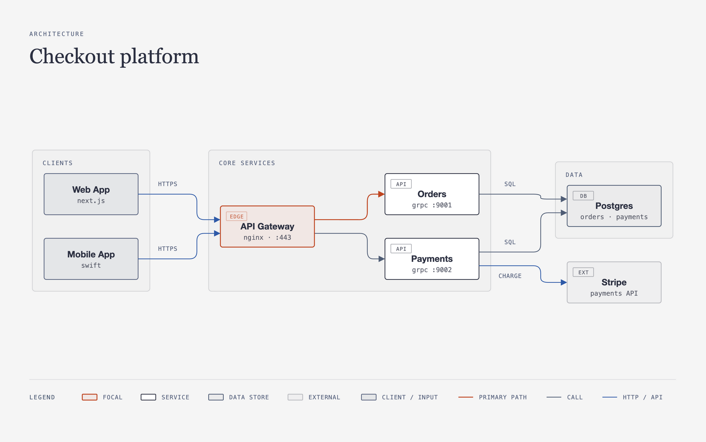
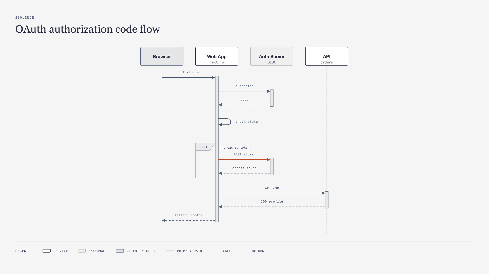
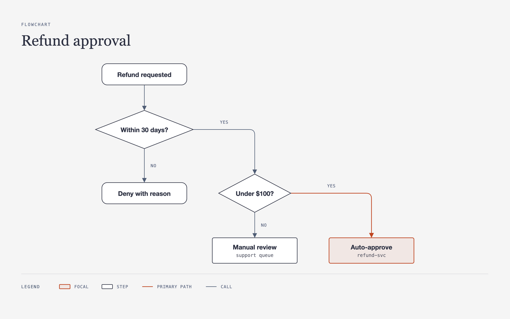
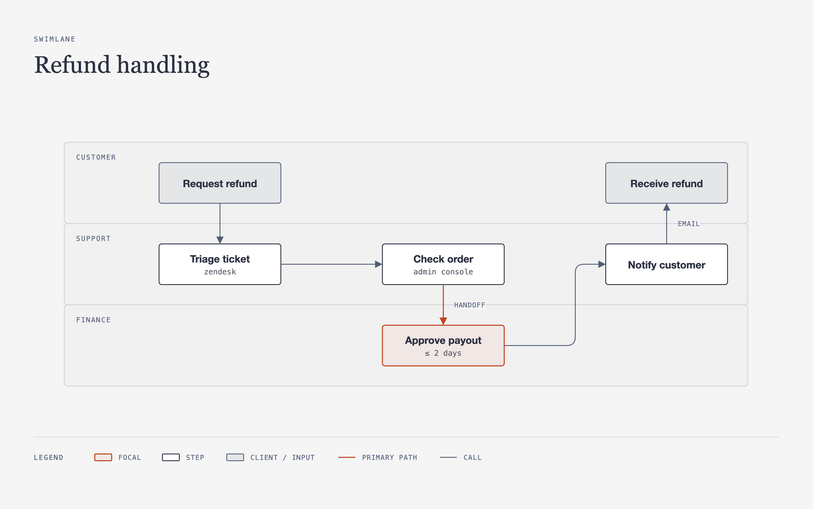
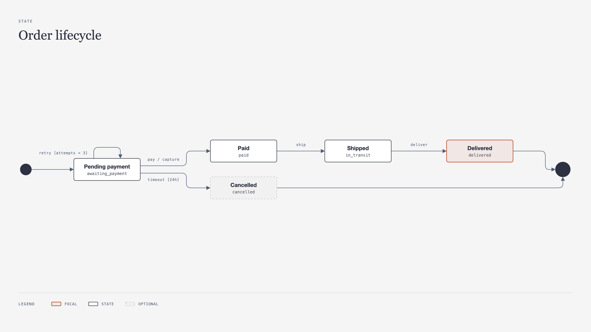
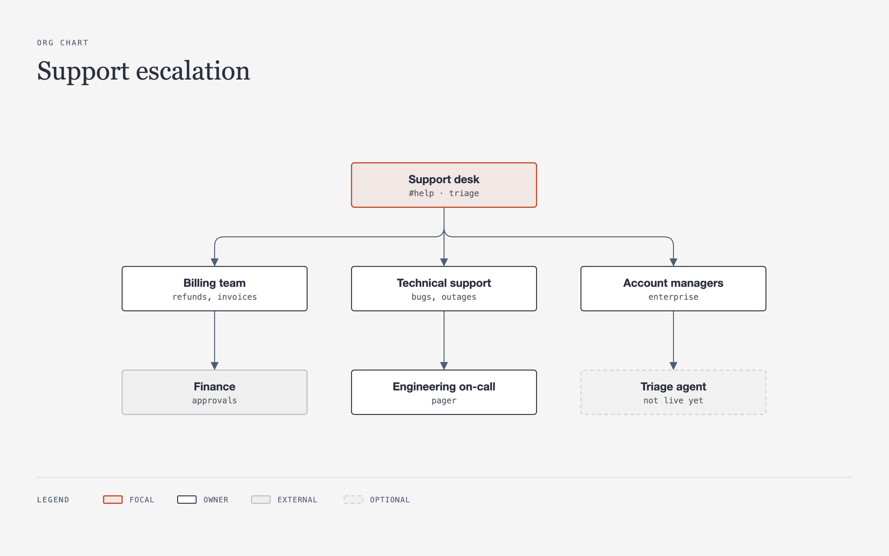
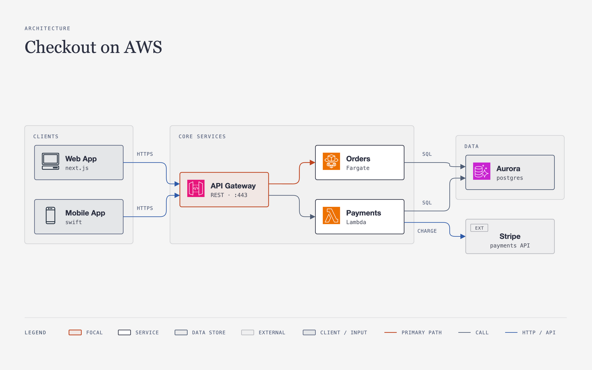

# draw-design

Editorial, on-brand diagrams as **native, editable draw.io files**, for Claude Code and Codex.

You describe a system, a process or a flow. The agent picks the diagram type and writes a compact **Diagram Spec** (`*.dd.json`). The bundled `ddraw` compiler then:

- lays the diagram out on a 4px grid;
- routes right-angle connectors that never overlap or pass behind boxes;
- applies your brand theme;
- lints the result against editorial rules;
- writes a `.drawio` file you can keep editing in draw.io Desktop, diagrams.net or the VS Code draw.io extension.

PNG, SVG and PDF exports go through the draw.io Desktop command line.

| | |
|---|---|
|  |  |
|  |  |
|  |  |
|  | |

> Status: early development (v0.1). See [`docs/prd.md`](docs/prd.md) for the full spec and roadmap, and its §22.10 for what is implemented.

## What it does today

| Capability | Command |
|---|---|
| 8 diagram types: architecture, flowchart, sequence, swimlane, state machine, tree, org chart, layer stack | `ddraw build spec.dd.json` |
| Official AWS, Google Cloud, Azure and Kubernetes icons (about 2,000, verified to render in draw.io, offline), in vendor colours or monochrome | `ddraw icons search "sqs queue" --platform aws`, then `"icon": "aws4:sqs"` |
| Validated spec with JSON-pointer errors and "did you mean" fixes | `ddraw validate`, `ddraw new <type>` |
| Editorial lint of any draw.io file (structure, 4px grid, budgets, connector rules, palette, fonts, legend, unsafe links) | `ddraw lint file.drawio` |
| Export PNG / SVG / PDF / editable `.drawio.png` / `.drawio.svg`, with accessible SVG titles | `ddraw export file.drawio --format png` |
| Brand profiles per client, selected per project by a `.draw-design` marker | `ddraw profile new/use/list/show` |
| Restyle an existing draw.io file to the theme, keeping its layout | `ddraw import legacy.drawio --snap` |
| Environment check | `ddraw doctor` |

## Install

**Claude Code**

```text
/plugin marketplace add george4data/draw-design
/plugin install draw-design@draw-design
```

**Codex**

```bash
codex plugin marketplace add george4data/draw-design
codex plugin add draw-design@draw-design
```

**Standalone skill** (any Agent Skills host): symlink `skills/draw-design` into your host's skills folder, e.g. `~/.claude/skills/draw-design`.

Requirements: Python ≥ 3.10 (standard library only). Optional: [draw.io Desktop](https://github.com/jgraph/drawio-desktop/releases) for export and preview. For faithful exports, also install the theme fonts: Instrument Serif, Geist and Geist Mono (all SIL OFL).

```bash
skills/draw-design/bin/ddraw doctor
```

## Usage

Ask for a diagram in plain language. The skill activates when you mention draw.io or a diagram type. The agent then:

1. picks the type;
2. writes the spec;
3. builds the file;
4. looks at a rendered preview;
5. hands you the `.drawio` file, with the `.dd.json` spec next to it.

### Example prompts

```text
Draw the architecture of this repo as a draw.io diagram.
Make a sequence diagram of our OAuth login: browser, web app, auth server, API.
Flowchart for refund approval: amounts over $500 need manager sign-off, otherwise auto-approve.
Swimlane of the release process across Dev, QA and Ops.
State machine for an order: placed, paid, shipped, delivered, cancelled.
Org chart for the platform team.
Layer diagram of our stack: UI, API, services, data.
```

### Cloud architecture with official icons

Name the platform, and the agent looks up each service in the bundled icon catalog (AWS, Google Cloud, Azure, Kubernetes). If your repo has Terraform, CloudFormation or Kubernetes manifests, the agent can usually work out the platform itself.

```text
Architecture of our checkout on AWS: API Gateway, an orders service on Fargate,
payments on Lambda, Aurora Postgres, and Stripe as an external API. Use AWS icons.

Same diagram with monochrome icons.

Draw our GKE deployment with Google Cloud icons: Cloud Load Balancing, GKE, Cloud SQL, Pub/Sub.
```

### Getting a better diagram

| Say | Effect |
|---|---|
| "highlight the payment path" | puts the accent colour on what matters (at most two elements) |
| "for executives" / "for engineers" | sets how technical the labels are |
| "slide-sized" / "wide, for a doc" / "fit to content" | picks the canvas size |
| "leave out monitoring and logging" | keeps the diagram focused. Diagrams are capped at about 9 boxes, so for big systems ask for an overview plus one detail diagram per area |
| "top to bottom" / "left to right" | sets the flow direction |

### Editing and follow-ups

The spec (`<name>.dd.json`) is kept next to the diagram. Follow-up requests change the spec and rebuild the diagram cleanly:

```text
Move Redis into the data zone.
Add a queue between orders and payments.
Rename "API" to "Public API" and make it the focal point.
```

### Other things to ask for

| Ask | Or run (Claude Code) |
|---|---|
| "Export it as a PNG for the README" / "as SVG" / "as PDF" | `/draw-design:export file.drawio` |
| "Check this diagram" (any `.drawio`, including hand-made ones) | `/draw-design:check file.drawio` |
| "Restyle this old diagram to our theme" | `/draw-design:import-drawio file.drawio` |
| "Use our brand colours: navy #1d3557, accent #e63946" | `/draw-design:profile` |
| "Why isn't export working?" | `/draw-design:doctor` |

In Codex, ask the same things in plain language. The skill is picked up the same way.

Open the `.drawio` file in draw.io Desktop, at [app.diagrams.net](https://app.diagrams.net), or with the VS Code "Draw.io Integration" extension. draw.io Desktop is needed only for exports and the agent's visual check.

## Quick start (CLI)

You can also drive the compiler directly:

```bash
DD=skills/draw-design/bin/ddraw
$DD types                                   # shipped diagram types
$DD new architecture -o app.dd.json         # scaffold a spec
$DD icons search "sqs queue" --platform aws # find a vendor icon id
$DD build app.dd.json                       # → app.drawio (only written when lint is clean)
$DD export app.drawio --format png          # → app.png (2×, transparent)
```

## How it relates to the official draw.io plugin

jgraph publishes an official draw.io skill that authors Mermaid or raw XML. draw-design is complementary. It focuses on:

- **editorial quality:** density budgets, one focal accent, connector rules, type-specific layouts;
- **brand theming:** client profiles selected per project;
- **restyling** existing diagrams to a house style.

## Development

```bash
make venv     # .venv with pytest, ruff, mypy (via uv)
make check    # ruff + mypy --strict + pytest + docs/package checks
make render   # rebuild gallery/ and render PNGs (needs draw.io Desktop)
make shapes   # rebuild the vendor icon catalog (maintainers; needs draw.io Desktop)
```

Read [AGENTS.md](AGENTS.md) first. Architecture decisions are recorded in [`docs/decisions/`](docs/decisions/).

## License

MIT. See [THIRD_PARTY_LICENSES.md](THIRD_PARTY_LICENSES.md) for attributions (design rules adapted from [diagram-design](https://github.com/cathrynlavery/diagram-design), MIT).
